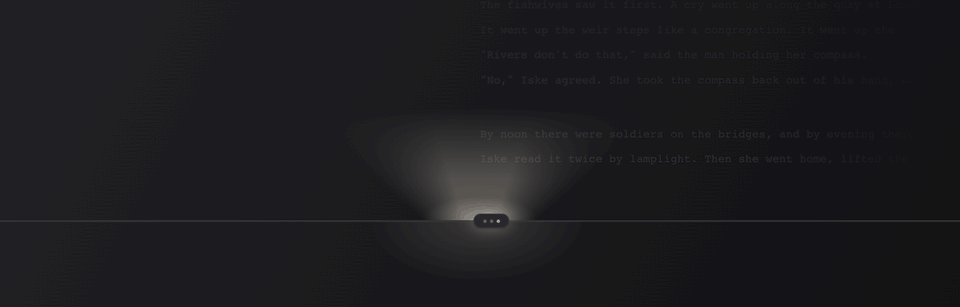
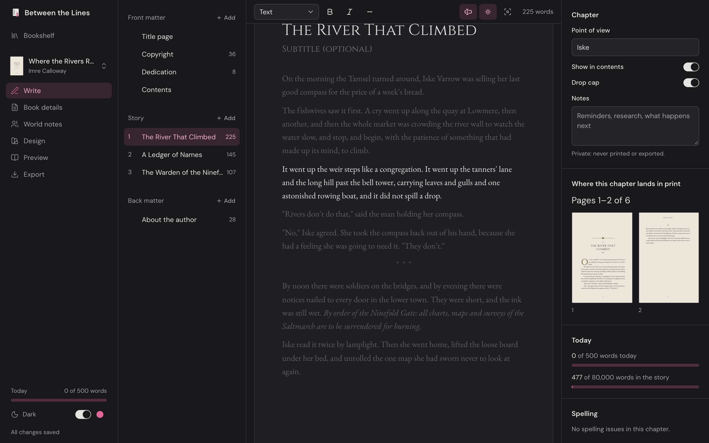
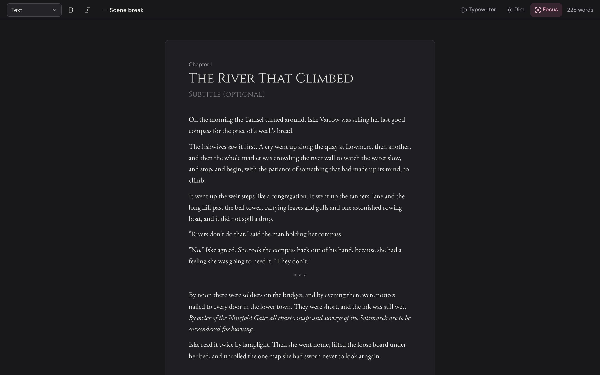
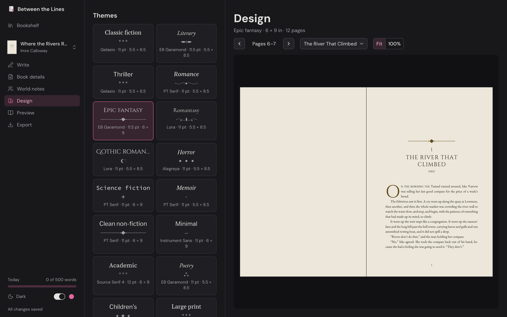
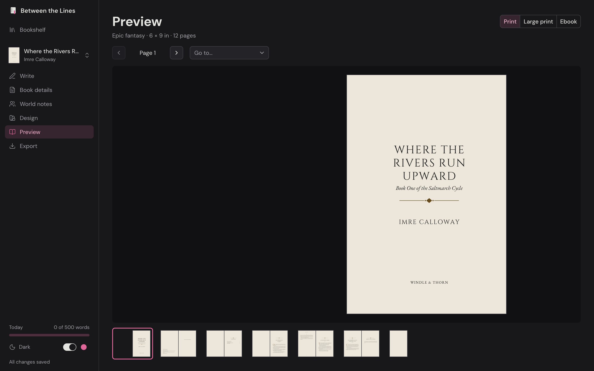
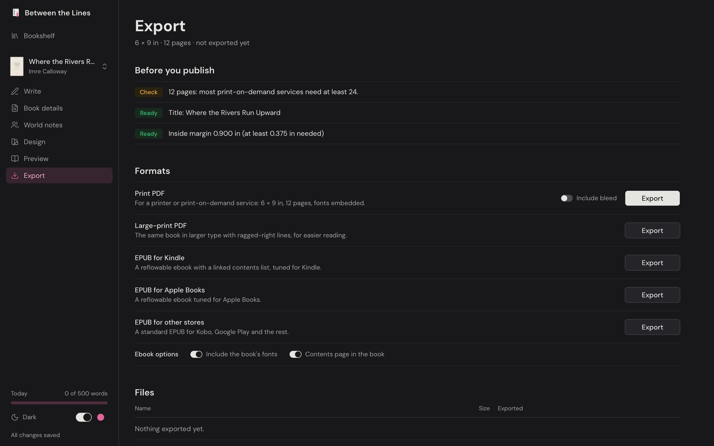
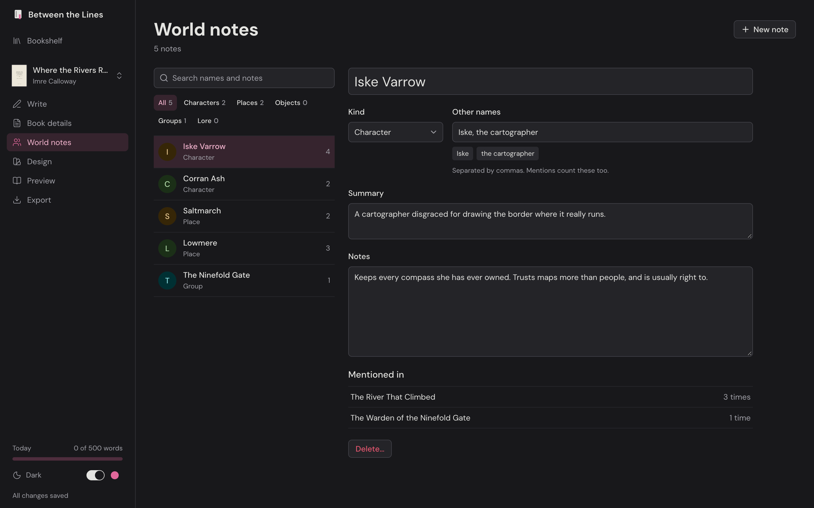
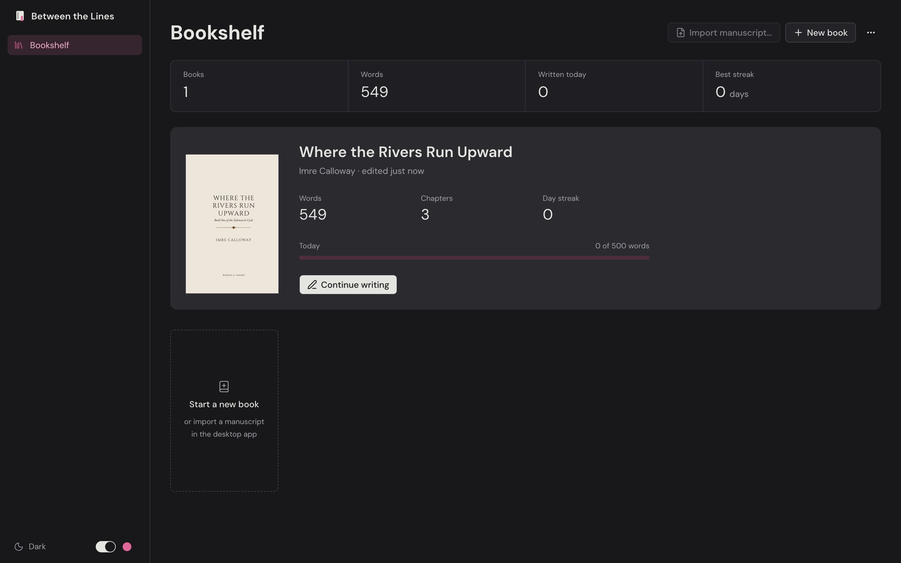
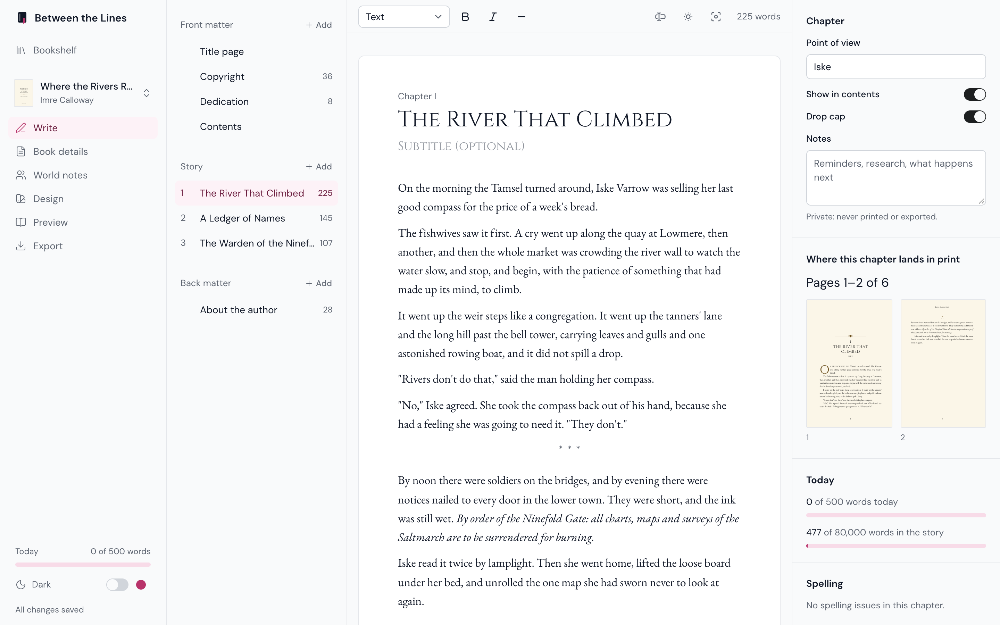

<div align="center">

<picture>
  <source media="(prefers-color-scheme: dark)" srcset="docs/logo-dark.svg">
  
</picture>

# Between the Lines

**Write your book, design its pages and publish it, free.**

A desktop app for indie writers that turns a manuscript into a print-ready PDF and store-ready
EPUBs. No subscription, no paywall, no AI. Your words stay on your computer.

[](https://github.com/shravanibnikam/between-the-lines/actions/workflows/ci.yml)
[](LICENSE)


[Features](#features) · [Get started](#get-started) · [How it works](#how-it-works) · [Contributing](CONTRIBUTING.md)

<br>


</div>

## Why Between the Lines

Formatting a book shouldn't cost more than writing it. The polished formatting apps charge a
licence fee or a subscription, and some lock export behind a paywall. Between the Lines is free
and open source, and it does the core job well.

| | |
|---|---|
| **Free, for good** | MIT licensed. Every design and every export format is included, with no licence keys. |
| **Private by design** | No account, no cloud, no AI and no telemetry. The app makes no network requests, so your manuscript never leaves your machine. |
| **Real typesetting** | Whole-paragraph line breaking (Knuth–Plass, the method behind TeX), hyphenation, drop caps, running heads and proper page furniture. |
| **Ready for print and stores** | Print PDF with optional bleed (and PDF/X-1a for printers such as IngramSpark), a large-print edition, and EPUBs for Kindle, Apple Books and other stores. Every EPUB passes [EPUBCheck](https://www.w3.org/publishing/epubcheck/) in CI. |

## Features

### See the printed page while you write

The editor shows exactly where the current chapter lands in print ("Pages 12–19 of 214") and
updates as you type, with spell checking, daily and book word goals, and snapshots built in.

### Writing modes that keep you in the scene

Three switches in the editor toolbar, which you can combine however you like:

- **Typewriter:** the line you're typing stays a third of the way down the screen, so your eyes
  never chase the cursor to the bottom of the page.
- **Dim:** every paragraph except the one you're writing fades back, so the sentence in front of
  you is the only thing asking for attention.
- **Focus:** the sidebar, outline and panels disappear, leaving just you and the page. Turn on
  Typewriter as well and the page becomes a lamp-lit sheet of paper on a carriage. Your words
  roll in toward a type guide, with adjustable lamp brightness and warmth and an optional
  typewriter typeface.

<p align="center">
  
</p>

<table>
  <tr>
    <td width="50%"></td>
    <td width="50%"></td>
  </tr>
  <tr>
    <td align="center"><sub><b>Typewriter + Dim</b>: the current paragraph stays bright</sub></td>
    <td align="center"><sub><b>Focus</b>: nothing on screen but the page</sub></td>
  </tr>
</table>

### 17 designs, every setting adjustable

Classic fiction, literary, thriller, romance, fantasy, romantasy, gothic, horror, sci-fi, memoir,
non-fiction, minimal, academic, poetry, children's, large print and dyslexia-friendly. Each one
ships with open-licence fonts and its own ornaments. Tune the fonts, sizes, spacing, margins and
chapter openings, and see a live two-page spread as you go.



### Preview, check, export

Page through the print, large-print and phone-ebook versions. Before you publish, the pre-flight
checks flag what print-on-demand services will reject, such as page count, inside margins and a
missing title or author.

<table>
  <tr>
    <td width="50%"></td>
    <td width="50%"></td>
  </tr>
  <tr>
    <td align="center"><sub><b>Preview</b>: print, large print and ebook</sub></td>
    <td align="center"><sub><b>Export</b>: pre-flight checks, PDF and EPUB</sub></td>
  </tr>
</table>

### Your world, in one place

Keep notes on characters, places, objects, groups and lore. Names and aliases are counted in
every chapter they appear in, and the spell checker always accepts them.

<table>
  <tr>
    <td width="50%"></td>
    <td width="50%"></td>
  </tr>
  <tr>
    <td align="center"><sub><b>World notes</b>: characters, places and lore, with mentions</sub></td>
    <td align="center"><sub><b>Bookshelf</b>: all your books, word counts and streaks</sub></td>
  </tr>
</table>

### And also

- **Import** from Word (`.docx`), OpenDocument (`.odt`), Markdown and plain text. Footnotes and
  endnotes come across as footnotes.
- **Images and an ebook cover:** insert PNG or JPEG pictures with captions from the editor toolbar
  (maps, diagrams, illustrations), and pick a cover in Book details for the EPUBs.
- **Tables and footnotes:** tables print with clean horizontal rules and repeat their header on a
  new page; footnotes sit at the foot of the page that mentions them, and pop up in ebooks.
- **Front and back matter:** title page, copyright, dedication, epigraph, contents, foreword, prologue, parts, epilogue, acknowledgements, about the author, also by, and custom sections.
- **Snapshots** of the whole book, which you can restore at any time.
- **Command palette** on <kbd>Ctrl</kbd>/<kbd>⌘</kbd> + <kbd>K</kbd>.
- **Light and dark** themes, one switch in the sidebar. The screenshots above are in dark mode. Here's light:

<p align="center">
  
</p>

### Writing format

Chapters are plain text, one paragraph per line. The editor handles bold and italic for you; the
rest is a few Markdown-style lines:

| Type this | To get |
|---|---|
| `*italic*`, `**bold**` | italic, bold |
| `## Heading`, `### Smaller heading` | subheadings |
| `> A quoted passage` | a block quote |
| `***` on its own line | a scene break, drawn in the design's style |
| `` | an image with a caption (use the toolbar's Image button) |
| `\| Name \| Age \|` then `\|---\|--:\|` then `\| Ada \| 36 \|` | a table; the dashes row makes a header and `:` sets alignment |
| `as Pliny wrote[^1]` and, anywhere in the chapter, `[^1]: Natural History, book 2.` | a footnote, numbered per chapter |

## Get started

Download the latest version from the [Releases page](https://github.com/shravanibnikam/between-the-lines/releases/latest):

| System | File |
|---|---|
| macOS (Apple silicon and Intel) | `Between.the.Lines_…_universal.dmg` |
| Windows 10 and 11 | `Between.the.Lines_…_x64-setup.exe` (or the `.msi`) |
| Linux | `.AppImage` (any distribution), `.deb` (Debian, Ubuntu) or `.rpm` (Fedora) |

The app isn't signed with a paid developer certificate yet, so your system asks once before the
first launch:

- **macOS:** open the `.dmg` and drag the app to Applications, then open it. When macOS says it
  can't check the app, open **System Settings → Privacy & Security**, scroll down and click
  **Open Anyway**.
- **Windows:** if SmartScreen says "Windows protected your PC", click **More info**, then
  **Run anyway**.
- **Linux:** make the AppImage executable (`chmod +x Between.the.Lines_*.AppImage`) and run it.

### Build from source

**You'll need:**

- [Rust](https://rustup.rs)
- [Node.js](https://nodejs.org) 22 or newer
- Tauri's [system prerequisites](https://tauri.app/start/prerequisites/) for your platform: the Xcode Command Line Tools on macOS, WebView2 and the MSVC build tools on Windows, and WebKitGTK on Linux

```sh
git clone https://github.com/shravanibnikam/between-the-lines.git
cd between-the-lines/studio
npm install
./run.sh build        # release build, then open the app in target/release/bundle/
./run.sh dev          # or run it with hot reload while you work on it
```

Books are saved in your system's app data folder:
`~/Library/Application Support/Between the Lines` on macOS, `~/.local/share/Between the Lines` on
Linux, and `%APPDATA%\Between the Lines` on Windows. Each book is a folder holding `book.json`,
`images/`, `exports/` and `snapshots/`, so your work is easy to back up and never locked in.

## How it works

Rust does the typesetting and writes the files. The interface is React inside a
[Tauri](https://tauri.app) window. Every request from the interface goes through a single command
that reaches the Rust core, so the same API also runs over HTTP and the interface can be developed
in an ordinary browser.

| Path | What's there |
|---|---|
| [`core/`](core) | `bookbinder-core`: book model, storage, markup, typesetting (line breaking, hyphenation, pagination), PDF and EPUB writers, Word/ODT/Markdown import, spelling, themes, ornaments, page SVGs, and [`api.rs`](core/src/api.rs), every command the interface calls |
| [`core/assets/`](core/assets) | Bundled fonts (SIL Open Font License) and the en-US Hunspell dictionary |
| [`studio/`](studio) | The app: React, TypeScript, Tailwind and shadcn/ui in `src/`, the Tauri shell in `src-tauri/` |
| [`MECHANICS.md`](MECHANICS.md) | The typesetting numbers the app uses and where they live |
| [`studio/DESIGN.md`](studio/DESIGN.md) | The interface's design rules: colours, type, layout and states |

**Run the tests** (unit tests plus an end-to-end run of every API command against a temporary
library, then the interface's unit tests):

```sh
cargo test --manifest-path core/Cargo.toml
cd studio && npm test
```

**Work on the interface in a browser**, with real data and no Tauri window:

```sh
BOOKBINDER_DATA_DIR=/tmp/btl-dev cargo run --manifest-path core/Cargo.toml --example devserver
cd studio && npm run dev     # then open http://localhost:1420
```

## Roadmap

Ideas for future versions, with no dates promised: signed installers, series, version branches,
cover templates with spine-width calculation, and more hyphenation and spelling languages. AI
features are deliberately not on the list.

Have an idea or found a bug? [Open an issue](https://github.com/shravanibnikam/between-the-lines/issues).

## License

[MIT](LICENSE). Use it, change it and share it.

The bundled fonts are under the [SIL Open Font License 1.1](core/assets/fonts/FONTS.md), and the
English dictionary comes from [SCOWL](core/assets/dictionaries/README_en_US.txt) under its own
permissive licence. Books you make with Between the Lines are entirely yours.
